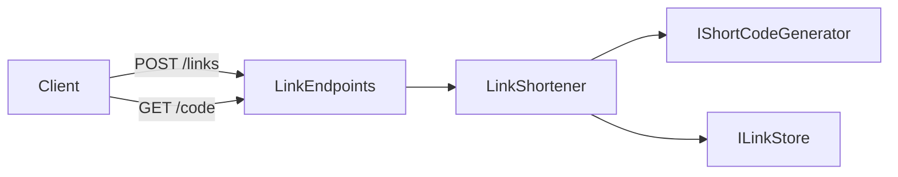

# Architecture

## Overview

A single ASP.NET Core minimal API. Everything about links lives in one folder,
`src/UrlShortener/Links/`, because the project is small enough that layers would only add
indirection.

| Type | Responsibility |
|---|---|
| `LinkEndpoints` | HTTP only: maps routes, validates input, turns results into status codes. |
| `LinkShortener` | The rules: valid targets, creating links, retrying on collisions. |
| `IShortCodeGenerator` | Produces candidate codes. Default: `RandomShortCodeGenerator`. |
| `ILinkStore` | Saves and finds links. Default: `InMemoryLinkStore`. |
| `Contracts.cs` | Request and response shapes of the API. |

## Creating a link

1. `POST /links` arrives with a URL.
2. `LinkShortener.IsValidTarget` rejects anything that isn't an absolute `http`/`https` URL → `400`.
3. `LinkShortener.Shorten` asks the generator for a code and tries to add the link to the store.
4. If the code is taken (a *collision*), it tries again, up to `MaxAttempts` times.
5. The endpoint returns `201 Created` with the short URL.

## Storage

Links are kept in memory (`InMemoryLinkStore`) and **lost on restart**. That's on purpose
for this sample: the repo runs with nothing but the .NET SDK. A persistent store only needs
to implement `ILinkStore`; its `TryAdd` must be atomic (two links must never get the same
code).

## Things that are deliberately missing

- Custom short codes, expiry, click statistics, authentication.
- Deduplication: shortening the same URL twice creates two links (see the glossary's
  definition of *shorten*).
