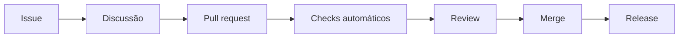

<div
  v-motion
  :initial="{ y: 30, opacity: 0 }"
  :enter="{ y: 0, opacity: 1, transition: { delay: 150 } }"
>
<p class="eyebrow">Dev Growth Talks</p>
<h1>Escrito para <span class="accent">estranhos</span></h1>
<p class="lead">o que o open source pode ensinar ao seu time</p>
</div>

<p class="byline">Rodrigo Nascimento</p>

<!--
Nada de introdução sobre open source ainda. Vai direto pra história.
-->

---

# Um ticket simples

<v-clicks>

- Uma mudança pequena num projeto **herdado**
- O time que criou **não existe mais**
- Quem escreveu **já saiu**
- Documentação: **nenhuma**
- O código: difícil de ler

</v-clicks>

<p v-click class="lead big">Antes da tarefa, a sprint ganha um <em>spike</em>.<br>Só pra entender como aquilo funciona.</p>

<!--
Conta como "imagina um ticket…". Todo mundo vai reconhecer.
[click] Projeto herdado.
[click] O time que criou não existe mais.
[click] Os devs originais já saíram da empresa.
[click] Documentação: nenhuma.
[click] E o código é difícil de ler.
[click] Antes da tarefa de verdade, entra um spike na sprint só pra entender como funciona.
-->

---
class: title-slide
---

<p class="lead big">Quem aqui já fez esse spike?</p>

<p v-click class="lead big">E quando ele acabou… pra onde foi o que você aprendeu?</p>

<p v-click class="lead">Pra sua cabeça. Pra uma mensagem no chat. <em>Pra lugar nenhum.</em></p>

<!--
Pergunta e espera as mãos (ou reações no Meet). Não tenha pressa.
[click] Segunda pergunta: pra onde foi o que você aprendeu?
[click] Resposta: pra cabeça de alguém, pro chat, pra lugar nenhum.
Esse spike é o fio condutor: a gente volta nele na memória do projeto e no final.
-->

---

# O open source vive isso todo dia

<v-clicks>

- Mantenedores **vão embora**
- Contribuidores são **estranhos**
- Outros países, outros fusos, outros idiomas
- Ninguém pode ir até a mesa do autor e perguntar

</v-clicks>

<p v-click class="lead big">E mesmo assim, tem projeto que dura <em>décadas</em>.</p>

<!--
[click] Mantenedores saem.
[click] Quem contribui é estranho.
[click] Outros países, fusos e idiomas.
[click] Não existe "vou perguntar pro fulano".
[click] E ainda assim alguns projetos rodam há décadas.
Transição: "Então como um projeto sobrevive quando TODO MUNDO é um estranho?"
-->

---
class: title-slide
---

<p class="eyebrow">A palavra desta talk</p>

# Contribuidor

<p class="lead big">Qualquer um que altera o projeto.</p>

<p v-click class="lead">Guarda essa palavra. Mais pra frente ela vai incluir alguém que <em>não é uma pessoa</em>.</p>

<!--
Define "contribuidor": qualquer um que muda o projeto.
[click] Planta a semente: mais tarde isso inclui agentes de IA.
-->

---

# Quem é quem

<div class="grid grid-cols-3 gap-5">
<div v-click class="card">

### Usuários

Usam o projeto.

</div>
<div v-click class="card">

### Contribuidores

Alteram o projeto.

</div>
<div v-click class="card card-accent">

### Mantenedores

Decidem o que entra.

</div>
</div>

<p v-click class="lead">A maioria contribui uma ou duas vezes… e vai embora.<br>O projeto precisa estar pronto pra isso.</p>

<!--
[click] Usuários usam.
[click] Contribuidores alteram.
[click] Mantenedores decidem o que entra.
[click] A maioria contribui uma ou duas vezes e some. O projeto tem que estar preparado pra isso.
Leve: essa parte é mais pros estagiários.
-->

---

# O caminho de uma mudança



<v-clicks>

- **Pull request**: uma proposta. "Esta é minha mudança, por favor puxe ela pra dentro."
- A discussão acontece **antes** do código
- Os checks rodam **antes** do review

</v-clicks>

<!--
Mostra o fluxo inteiro rapidinho, no máximo um minuto no diagrama.
[click] Explica pull request pros estagiários: uma proposta de mudança.
[click] Repara na ordem: discute antes de escrever código.
[click] E a máquina checa antes de um humano revisar.
-->

---
class: title-slide
---

<p class="eyebrow">Por que tudo é escrito e assíncrono?</p>

<p class="lead big">Não tem corredor. Não tem daily. Não tem fuso em comum.</p>

# Se não está escrito, <span class="accent">não existe</span>.

<p v-click class="lead">A gente tem corredor. Por isso não escreve.<br><em>Aí o time vai embora, e o corredor vai junto.</em></p>

<!--
Opções de frase: "Open source não é documentado porque o pessoal é mais legal. É documentado porque senão morre." / "Lá, escrever não é burocracia; é o único jeito de conversar."
[click] O contraste: nós temos corredor, e é exatamente por isso que pulamos a parte de escrever. Aí o time sai e o corredor vai junto.
Transição: "Então um estranho aparece querendo ajudar. Qual a primeira coisa que ele vê?"
-->

---
class: title-slide
---

<p class="eyebrow">Parte 1</p>

# A porta de entrada

<p class="lead">Um bom repositório responde as perguntas <em>antes</em> de alguém perguntar.</p>

<!--
A partir daqui: os arquivos que um recém-chegado lê primeiro. Mostra os trechos, não lê eles. Uma frase por arquivo sobre o PORQUÊ.
-->

---

# README

<p class="lead">O teste: um estagiário consegue rodar o projeto no primeiro dia <em>só com o README</em>?</p>

<v-clicks>

- O que é, por que existe
- Como rodar, em poucos comandos

</v-clicks>

<div v-click>

<<< @/../examples/01-model-repo/README.md#quick-start md

</div>

<!--
Começa pela pergunta-teste.
[click] O que é e por que existe.
[click] Como rodar em poucos comandos.
[click] No repo modelo: dois comandos. Sem banco, sem segredo, sem serviço pra subir.
-->

---

# CONTRIBUTING

<p class="lead">Como a gente trabalha aqui.</p>

<blockquote>

**DON'T** surprise us with big pull requests. Instead, file an issue and start a discussion so we can agree on a direction before you invest a large amount of time.

<cite>dotnet/runtime · CONTRIBUTING.md</cite>
</blockquote>

<v-clicks>

- Branches, como rodar os testes, como é um bom PR, onde perguntar
- O GitHub mostra o link pra ele quando alguém abre uma issue ou PR

</v-clicks>

<!--
Trecho real do .NET runtime: não nos surpreenda com PRs grandes; abra uma issue antes e vamos concordar na direção.
[click] O que costuma ter: branches, testes, como é um bom PR, onde tirar dúvida.
[click] O próprio GitHub aponta pra ele na hora de abrir issue ou PR.
-->

---

# GLOSSARY

<p class="lead">As palavras <em>deste</em> projeto, e o que elas significam <em>aqui</em>.</p>

| Evite | Diga | Por quê |
|---|---|---|
| *slug* | short code | "Slug" costuma ser um caminho legível, escolhido por alguém. Nossos códigos são aleatórios. |
| *alias* | short code | Não suportamos códigos personalizados; "alias" sugere que sim. |
| *hash* | short code | Os códigos não são derivados da URL (ADR 0001). |

<p class="byline">GLOSSARY.md do repo modelo · "Words we don't use"</p>

<p v-click class="lead">"Slug", "short code", "target URL": três pessoas, três significados.</p>

<!--
No repo modelo, o glossário tem até uma tabela de palavras que a gente NÃO usa.
[click] Sem glossário, cada pessoa (e cada agente) usa um nome diferente pra mesma coisa.
-->

---

# Templates de issue e PR

<p class="lead">Fazem as perguntas certas logo no começo.</p>

<div class="cols">
<div class="card">

### Bug report do dotnet/runtime

- Description
- Reproduction Steps
- Expected behavior
- Actual behavior
- Regression? · Known Workarounds · Configuration

</div>
<div v-click class="card card-accent">

### A gente já tem template de PR

É a mesma ideia.<br>O open source só aplica ela às **issues** também.

</div>
</div>

<!--
Os campos reais do template de bug do .NET runtime: descrição, passos pra reproduzir, esperado, atual…
[click] Nós já usamos template de PR em todo projeto. É exatamente essa ideia, só que aplicada também às issues.
-->

---

# CODEOWNERS

<p class="lead">Quem precisa revisar mudanças em qual pasta.</p>

```txt
/src/coreclr/jit/     @dotnet/jit-contrib
/.github/workflows/   @jeffhandley @dotnet/runtime-infrastructure
```
<p class="byline">dotnet/runtime · .github/CODEOWNERS</p>

<v-click>

O PR chama as pessoas certas **sozinho**. Ninguém precisa saber quem marcar.

</v-click>

<p v-click class="lead">…e cada um desses arquivos também é lido por um <em>agente</em>. Guarda essa.</p>

<!--
Trecho real do CODEOWNERS do .NET runtime.
[click] O PR pede review das pessoas certas automaticamente.
[click] Callback: todos esses arquivos também são lidos por agentes. Guarda essa ideia.
Transição: "Esses arquivos dizem como trabalhar HOJE. Mas e as decisões de quem já foi embora?"
-->

---
class: title-slide
---

<p class="eyebrow">Parte 2</p>

# A memória do projeto

<p class="lead big">O spike não era sobre <em>o quê</em> o código faz.<br>Era sobre <span class="accent">por quê</span>.</p>

<p v-click class="lead">Código não guarda o porquê. Pessoas guardam. E pessoas vão embora.</p>

<!--
Volta pro spike do começo: o "o quê" você descobre lendo código. O que faltava era o PORQUÊ.
[click] Código não guarda o porquê. Gente guarda. E gente sai.
-->

---

# docs/

<p class="lead">Um arquivo por assunto.</p>

<div class="cols">
<div>

```txt
docs/
  README.md          índice
  architecture.md    como o código se organiza
  api.md             a API e como ela é documentada
  adr/               decisões
```

</div>
<div v-click class="card">

### Em vez de uma wiki gigante

Arquivos pequenos que as pessoas **encontram** e **atualizam**.<br>Não uma página enorme em que ninguém confia.

</div>
</div>

<!--
No repo modelo: docs/ com um arquivo por tema.
[click] Arquivos pequenos são achados e atualizados. A wiki gigante ninguém confia.
-->

---

# ADR: Architecture Decision Record

<p class="lead">Um arquivo curto por decisão.</p>

<div class="flex gap-3 my-6">
<div v-click class="card">Título</div>
<div v-click class="card">Status</div>
<div v-click class="card">Contexto</div>
<div v-click class="card">Decisão</div>
<div v-click class="card">Consequências</div>
</div>

<p v-click class="lead">Um ADR aceito <strong>nunca</strong> é editado pra mudar a decisão.<br>Um novo ADR <em>substitui</em> o antigo. Esse é o histórico que o spike procurava.</p>

<p class="byline">Formato de Michael Nygard (2011) · exemplo público: github.com/arachne-framework/architecture</p>

<!--
ADR é a ideia mais nova pra maioria. Vai devagar.
[click] Título. [click] Status. [click] Contexto: qual problema, quais forças. [click] Decisão. [click] Consequências: o que fica mais fácil, o que fica mais difícil.
[click] Ponto-chave: não se edita a decisão. Um ADR novo substitui o antigo. Esse histórico é exatamente o que o spike estava procurando.
-->

---

# ADR 0001 · Como gerar os short codes

<<< @/../examples/01-model-repo/docs/adr/0001-short-code-generation.md#decision md

<v-clicks>

- Opções descartadas: IDs sequenciais (dá pra adivinhar), hash da URL (colide e vaza URLs), GUID (nada "short")
- Agora ninguém "conserta" o retry achando que é bug

</v-clicks>

<!--
Mostra o ADR do repo modelo. É curto; vale ler a decisão inteira.
[click] As alternativas e por que perderam. Isso é o porquê.
[click] Com isso escrito, ninguém (nem humano, nem agente) "conserta" uma decisão tomada de propósito.
-->

---

# CHANGELOG

<p class="lead">O que mudou, escrito pra humanos.</p>

<<< @/../examples/01-model-repo/CHANGELOG.md#v1 md

<p class="byline">Formato: keepachangelog.com · Added / Changed / Fixed / Removed / Security</p>

<!--
Não é o git log. É o que mudou, pra quem usa.
-->

---

# Documentação junto do código

<div class="cols">
<div>

### Pra quem **lê** o código: XML docs

<<< @/../examples/01-model-repo/src/UrlShortener/Links/ILinkStore.cs cs

</div>
<div v-click>

### Pra quem **usa** a API: `[Description]`

<<< @/../examples/01-model-repo/src/UrlShortener/Links/Contracts.cs#contracts cs

</div>
</div>

<!--
Dois públicos, duas ferramentas.
Esquerda: XML doc comments, pra quem lê e chama o código. Aparecem no hover da IDE.
[click] Direita: [Description] nos contratos. Isso vai pro OpenAPI, pra quem consome a API.
Nos dois casos, a doc fica em cima da coisa que ela descreve, então muda no mesmo diff.
-->

---
class: title-slide
---

<p class="lead big">Docs no repositório são revisadas<br>no <span class="accent">mesmo PR</span> que o código.</p>

<p v-click class="lead">A wiki apodrece. A doc no PR tem um revisor perguntando:<br><em>"você atualizou isso aqui?"</em></p>

<!--
A regra que faz tudo funcionar.
[click] Wiki apodrece. Doc no PR ganha revisor.
Transição: "Até aqui, tudo depende das pessoas fazerem a coisa certa. O open source não confia nisso, e não é por ser cínico."
-->

---
class: title-slide
---

<p class="eyebrow">Parte 3</p>

# Deixe a máquina dizer não

<p class="lead big">Você faria merge do PR de um <em>estranho</em><br>sem saber se ele compila?</p>

<!--
Pergunta pra sala. Espera.
-->

---

# Quando os checks rodam?

<div class="cols">
<div class="card">

### Depois do merge

O problema aparece quando **já está na main**.<br>Todo mundo já puxou.

</div>
<div v-click class="card card-accent">

### No pull request

O problema aparece enquanto ainda é **a branch de uma pessoa**.<br>Vermelho = não dá merge.

</div>
</div>

<v-clicks>

- O revisor nunca precisa ser o chato da formatação ou do teste quebrado. **A máquina disse não.**
- Required checks: a plataforma **obriga**. Ninguém precisa lembrar.

</v-clicks>

<!--
Esquerda: checks depois do merge. O problema chega na main.
[click] Direita: checks no PR. O problema fica na branch de quem fez.
[click] Efeito colateral 1: o revisor não precisa ser o chato.
[click] Efeito colateral 2: required checks. A plataforma garante.
Não cita produto de CI: o ponto é QUANDO roda, não qual ferramenta.
-->

---

# O CI do repo modelo

<div class="cols">
<div>

<<< @/../examples/01-model-repo/.github/workflows/ci.yml#triggers yaml

<v-clicks>

- Compila com warnings como erro (inclusive XML docs faltando)
- Formatação
- Testes, **inclusive da documentação da API**

</v-clicks>

</div>
<div v-click>

```txt
Failed Every_contract_property_is_described
  LinkResponse.shortUrl has no [Description].

Failed Every_parameter_is_described
  GET /{code}: parameter 'code' has no description.
```

</div>
</div>

<!--
O gatilho é pull_request: roda antes do merge.
[click] Build com warnings como erro: XML doc faltando quebra o build.
[click] Formatação.
[click] Testes, inclusive testes que checam a documentação do OpenAPI.
[click] Essa é a saída real quando alguém tira um [Description]. Documentação vira parte do "pronto", e quem diz não é a máquina.
-->

---

# Cultura de review

<v-clicks>

- **PRs pequenos.** O PR de 2.000 linhas de um estranho não é revisado. É ignorado.
- **Revise o código, não a pessoa.** "Este método…", não "você…"
- **Rotule o feedback** ([Conventional Comments](https://conventionalcomments.org/))

</v-clicks>

<div v-click>

```txt
issue (blocking): this accepts javascript: URLs.
suggestion: extract this into a method?
nitpick (non-blocking): extra blank line.
```

</div>

<p v-click class="lead">…e quando o contribuidor é um agente, é isso que pega os erros dele.</p>

<!--
Agora que a máquina cuida da parte chata, o review humano foca no que importa.
[click] PRs pequenos.
[click] Revise o código, não a pessoa.
[click] Rotule o feedback.
[click] Exemplos: o rótulo diz se bloqueia ou não. Tira a adivinhação, principalmente entre idiomas diferentes.
[click] Callback pros agentes. Transição: "Vamos falar do contribuidor mais novo de todo time."
-->

---
class: title-slide
---

<p class="eyebrow">Parte 4</p>

# Agentes de IA também são <span class="accent">contribuidores</span>

<p class="lead big">O recém-chegado definitivo: <em>zero contexto, toda vez</em>.</p>

<!--
Payoff da palavra: contribuidor pode ser pessoa ou agente.
O agente não lembra da conversa de ontem. Toda sessão é o primeiro dia dele.
-->

---
class: title-slide
---

<p class="lead big">Um agente é um estagiário com<br><span class="accent">energia infinita</span> e <span class="accent">nenhuma memória</span>.</p>

<v-click>

README · CONTRIBUTING · GLOSSARY · docs/ · ADRs

</v-click>

<p v-click class="lead">Tudo o que ajuda um estranho é <em>contexto pro agente</em>.<br>Um agente que lê um ADR não "conserta" uma decisão tomada de propósito.</p>

<!--
[click] Tudo das partes 1 e 2…
[click] …também é contexto pro agente. Um agente que leu o ADR 0001 não vai trocar o retry por um contador.
-->

---

# AGENTS.md

<blockquote>

A simple, open format for guiding coding agents

<cite>agents.md</cite>
</blockquote>

<div class="cols">
<div>

<<< @/../examples/01-model-repo/AGENTS.md#boundaries md

</div>
<div v-click class="card">

### O CONTRIBUTING dos agentes

Como compilar, como testar, convenções, o que não mexer.

Arquivos específicos de ferramenta (`.github/copilot-instructions.md`, `CLAUDE.md`…) só **apontam** pra ele.

</div>
</div>

<!--
AGENTS.md: um formato aberto que vários agentes de código leem.
Mostra os limites do repo modelo: não adicionar pacote sem issue, não mexer no CI pra passar, manter a mudança pequena.
[click] É o CONTRIBUTING dos agentes. Os arquivos de cada ferramenta só apontam pra ele, pra não divergirem.
Fica neutro: o ponto são os arquivos, não qual agente usar.
-->

---

# Uma boa issue é um bom prompt

<<< @/../examples/01-model-repo/.github/ISSUE_TEMPLATE/feature_request.yml#acceptance yaml

<v-clicks>

- Contexto, comportamento esperado, critérios de aceite
- Os checks no PR pegam erros de agentes do mesmo jeito que pegam os nossos
- Agentes abrem **mais** PRs: checks automáticos importam **mais**, não menos

</v-clicks>

<!--
O template de feature do repo modelo pede critérios de aceite, e diz explicitamente: isso deixa a issue trabalhável por qualquer um, humano ou agente.
[click] Issue boa = prompt bom.
[click] A parte 3 vale pros agentes também.
[click] Mais PRs, mais importância dos checks.
-->

---
class: title-slide
---

<p class="lead big">Instruções geradas a partir do código<br>são um ótimo começo.</p>

<p v-click class="lead big">Mas elas <span class="accent">envelhecem</span>.</p>

<p v-click class="lead">Revise como código. Atualize no mesmo PR da mudança.</p>

<!--
[click] Elas divergem do código com o tempo (drift).
[click] Então trate como código: revisa, e atualiza no mesmo PR.
Transição: "Nada disso é exclusivo de open source. Inclusive, tem nome."
-->

---
class: title-slide
---

<p class="eyebrow">Trazendo pra casa</p>

# Inner source

<p class="lead big">Práticas de open source dentro de uma empresa.</p>

<p class="byline">Termo criado por Tim O'Reilly, em 2000</p>

<!--
Tem nome: inner source. Usar as práticas de open source dentro de casa.
-->

---
class: title-slide
---

# Todo spike deixa um <span class="accent">documento</span> para trás.

<<< @/../examples/01-model-repo/CONTRIBUTING.md#spikes md

<!--
Volta pro spike do começo.
O resultado de um spike não é só uma resposta na cabeça de alguém: é um arquivo em docs/, um ADR ou uma entrada no glossário, commitado.
Ninguém paga duas vezes pelo mesmo entendimento. No repo modelo isso está no CONTRIBUTING.
-->

---

# Por onde começar

<v-clicks>

1. Um **README** que faz um recém-chegado rodar o projeto
2. Um **CONTRIBUTING**: como a gente trabalha aqui
3. **Checks no PR**, antes do merge
4. **docs/ + ADRs**, alimentados pelos spikes
5. Um **GLOSSARY**
6. Um **AGENTS.md**

</v-clicks>

<!--
Checklist em ordem de esforço.
[click] README. [click] CONTRIBUTING. [click] Checks no PR. [click] docs/ e ADRs, alimentados pelos spikes. [click] Glossário. [click] AGENTS.md.
-->

---
class: title-slide
---

<p class="lead big">Não faça tudo.</p>

# Comece com <span class="accent">um arquivo</span>.

<p class="lead">Em um repositório. Na próxima vez que você mexer nele.</p>

<!--
Sem plano grandioso. Um arquivo, um repo, na próxima vez.
-->

---
class: title-slide
---

<p class="lead big">Um estranho. Um estagiário novo. Você daqui a seis meses. Um agente.</p>

<p v-click class="lead big">Todo contribuidor precisa da mesma coisa:<br><span class="accent">contexto, escrito no repositório</span>.</p>

<h1 v-click>Escreva para estranhos.<br>Cedo ou tarde, todo mundo é um.</h1>

<!--
Fecha no takeaway.
[click] Todo contribuidor precisa de contexto escrito no repo.
[click] Frase final. Pausa.
Alternativa: "Escreva como se você fosse sair amanhã. Um dia você vai."
-->

---
class: title-slide
---

<p class="eyebrow">Vamos conversar</p>

# Qual destes teria salvado o nosso último spike?

<div class="mt-6">

**Artigo:** rodrigofnascimento.github.io/open-source-software<br>
**Repositório:** github.com/RodrigoFNascimento/open-source-software

</div>

<!--
Abre a discussão. Essa pergunta é a ponte entre a talk e uma decisão do time.
O repo modelo serve de ponto de partida.
-->
